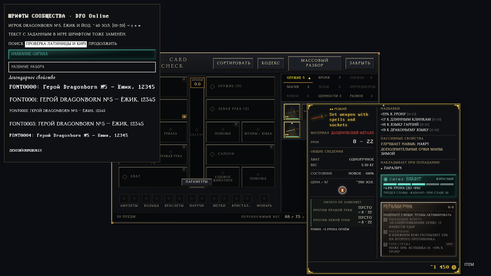
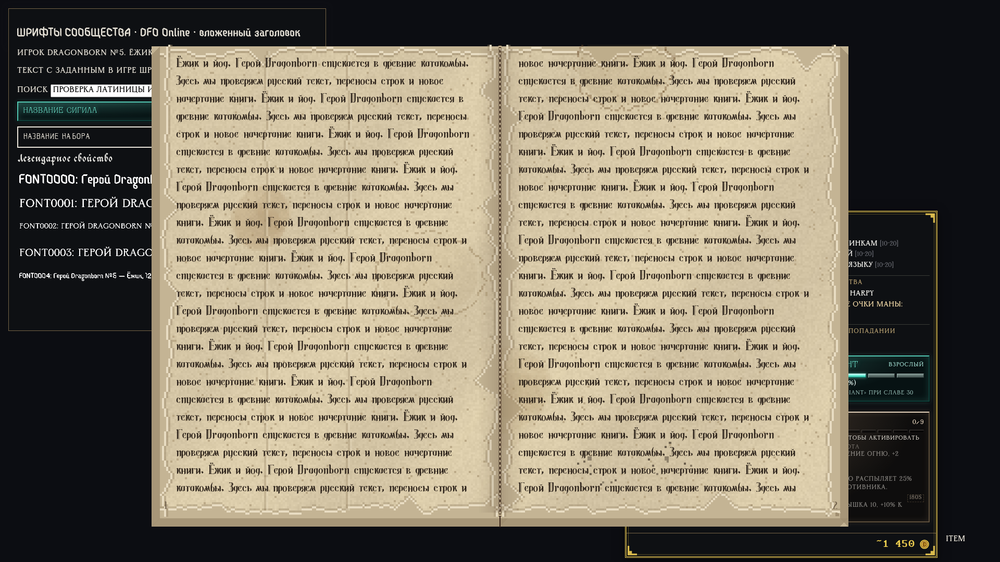

# Общие шрифты игры · 1.21.0

Калибровка 1.21.1, включая Greengoth +2 и сохранение небольших подписей надетых
предметов, описана отдельно: [калибровка интерфейса](ui-calibration.md).
Последующие изменения размеров книг, счётчиков и обычного текста —
[читаемость 1.21.2](readability-1.21.2.md).

Отдельная галочка **«Шрифты сообщества»** включена по умолчанию.
Выбор сохраняется тем же способом, что остальные функции установщика.
Шрифты работают независимо от русификации и карточек предметов.
Отключение общей замены сохраняет собственное оформление карточек, если
функция карточек включена.

| Назначение | Файл пользователя |
|---|---|
| Обычный текст, подписи, чат, журнал | Gabin |
| Заголовки окон и имена предметов, включая списки и экипировку | Greengoth Expanded |
| Книги в классическом и перелистываемом интерфейсе | Hangyaku |
| Основные числа и цены карточек | Flexi IBM VGA False |
| Название сигила | Ckazka |
| Название набора | Ritalin |
| Название легендарного свойства | Wolgadeutsche |

Все семь файлов сохранены без изменения исходных байтов. Авторство и доступные
лицензионные сведения — [FONT-NOTICES.txt](../src/mod/fonts/FONT-NOTICES.txt).
Регистр самих строк не меняется; рисунок букв определяется шрифтом.
Если символ отсутствует в назначенных для этой роли файлах, браузер сохраняет его отображение
через системный резерв. Это нужно для иконок, эмодзи и имён на других алфавитах.

Заменён вывод текста в HTML, SVG, обычном и Offscreen canvas, книгах и
классических экранах с FNT-шрифтами. Лаунчер использует те же локальные файлы.
Надписи, нарисованные внутри готовых изображений и текстур, остаются графикой;
смена шрифта их не перерисовывает. Динамические корабельные таблички с 1.21.0
тоже используют наши глифы; исходная таблица BLOCK удалена из генератора.
Нативные меню и диалоги операционной системы используют её оформление.

## Как работает

- Общий слой CSS задаёт семьи текста и заголовков, сохраняя размеры и цвета.
  Особые шрифты сигилов/наборов/легендарных свойств сохраняют свои роли.
  Вложенные части заголовка наследуют ту же роль: имя персонажа в шапке
  инвентаря не возвращается к основному шрифту из-за вложенного span.
- Входной модуль страницы ждёт загрузки локальных файлов. Это позволяет
  сразу строить canvas-атласы с правильными буквами и метриками.
  Загрузка использует объявления CSS: один FontFace на семейство, без
  дублирующих экземпляров. Ошибка книжного файла не блокирует входной модуль.
- Классические `makeFont`, `measureText` и `drawText` связаны с собственными
  глифами. Высота строки остаётся из FNT; измерение и отрисовка согласованы.
  Даже старые байты FNT из IndexedDB заменяются сгенерированными собственными
  данными. Отдельная ветвь измеряет canvas-шрифт книги тем же способом, что её художник.
  Классическая книга получает собственный кешированный вид FNT; общий шрифт
  других окон не меняется. Перелистываемая книга сразу использует загруженный
  Hangyaku и не разбивает текст на страницы повторно после открытия.
- Разбор canvas.font кешируется в пределах 128 коротких строк. Повторное
  назначение того же значения пропускает разбор и native setter. Реальный getter
  по-прежнему проверяется: resize, reset и save/restore не оставляют старый кеш.
- Обычные латинские/русские глифы готовятся перед первой загрузкой атласа.
  `drawScreenQuadRun` сохраняет пакетный вывод надписей над персонажами.
  Атласы разделены по рендерам и восстанавливаются при очистке текстур.
- Загрузчик старых сетевых шрифтов отключён. Встроенный выбор шрифта показывает
  действующий вариант «Шрифты сообщества»; личные настройки игры не переписываются.
  При отключении функции прежний выбор снова действует.
- Установка сохраняет исходный CSS лаунчера. Переустановка с `fonts=0`
  возвращает прежнее оформление, удаление расширения восстанавливает исходный ASAR.
  Активный ASAR содержит только семь собственных TTF/OTF. Прочие файлы шрифтов,
  включая Tiny5 старого русификатора, удаляются из его таблицы файлов. Данные
  восстановления хранятся отдельно от активных ресурсов, не выдаются странице.
  Чистые архивы обновлений и пользовательская ARENA2 не меняются: иначе ломаются
  хеши обновляющего клиента. Их старые шрифтовые пути обслуживает наша подмена.
- Сразу при чтении canvas.font, после reset/resize и перед первым текстом
  используется наш набор; попытка присвоить старое семейство переходит на него же.
  Контексты, работающие только с картинками, не выполняют эту работу.
- FontFace принимает только наши источники; FontFaceSet блокирует старые семейства
  и повторную регистрацию, включая объекты из другого JS realm.
  Декларации старых @font-face и прежняя предварительная загрузка удаляются.
- В module worker устанавливается та же политика и загружается семь файлов.
  Ранние сообщения и transferable буферы сохраняются, задачи воспроизводятся
  через MessageChannel с исходными границами microtask. После очереди канал
  закрывается; постоянных таймеров нет. Это даёт одноразовую стоимость запуска,
  а не постоянную работу в каждом кадре.
- Шрифтовые файлы с версией в URL используют immutable-кеш. Скрипты и старые
  пути с подменённым содержимым не кешируются как прежние шрифты.
- Сохранённый FNT больше не удерживает неиспользуемый рендерер: связи с атласом
  и владельцем используют WeakRef. Измеритель без рендерера не хранит GL-текстуру.

## Проверки

Оригинал: <https://github.com/Lattymoy/daggerfall-js-source>.
Исполнены ассеты **app-v0.1.14545**, проверенные по манифесту SHA-256.

- Все девять шрифтовых хуков найдены, повторно не применяются, результат разбирается
  как JavaScript. Проверены варианты с переводом и без него.
- Браузер подтвердил, что обычный русский/английский текст и заголовки
  действительно используют предоставленные файлы.
- Оба книжных рендера используют Hangyaku, переносы укладываются в ширину
  страницы. Настоящее перелистываемое окно строит шесть размеров шрифта один
  раз; после resize — ещё один раз, без пересчётов на неизменных кадрах.
  Искусственно недоступный Hangyaku даёт резервный текст, не зависание загрузки.
- Все пять настоящих `FONT0000..FONT0004.FNT` проходят свой построитель:
  их прежние глифы заменены данными из наших TTF, ширина совпадает с отрисовкой.
  Совместимые FNT воспроизводятся tools/build-font-defaults.py без чтения игры.
- Проверены canvas по умолчанию, сброс canvas, OffscreenCanvas, сохранение
  размера/курсива/жирности, разные рендеры и восстановление после очистки текстур.
- На записывающем порте рендера 1000 повторных строк дают 1000 пакетных вызовов,
  без повторных загрузок атласа. Это проверка вызовов API, а не замер FPS живой игры.
  Микрозамеры canvas и времени 1000 строк сохранены в машинном отчёте; это
  локальные CPU-замеры браузера, а не обещание такого же времени на любом ПК.
- С общими шрифтами пройдена матрица из 13 760 состояний карточек и
  132 сочетания экрана/положения. Содержимое родных интеграций сохраняется.
- Пройдены модульные проверки, тесты Go и установка/переустановка/удаление
  упакованным патчером. Проверены отдельное отключение и восстановление лаунчера.

Последний дополнительный прогон Win32-интерфейса (1.20.0) остановился до запуска
программы: переносимый Wine не смог инициализировать `user32/kernel32`.
Это ограничение среды; в 1.20.1 такой прогон повторно не выполнялся.

[Машинные результаты](game-fonts-checks.json). Полная сетевая сессия с персонажем
не выполнялась. Основные команды повторения: `test/fonts.test.cjs`,
`tools/test-fonts-browser.cjs`, `tools/test-item-card-states.cjs` и
`tools/audit-item-cards-browser.cjs`; для общей темы — `DFO_GLOBAL_FONTS=1`,
для упакованного кода — `DFO_CARD_MOD_DIR=.../dist/payload/mod`.

Углублённые проверки: `test/font-assets.test.cjs` и
`tools/test-font-policy-browser.cjs` — GC, старые источники, worker,
передача сообщений и неизменность пикселей настоящего image decoder.
