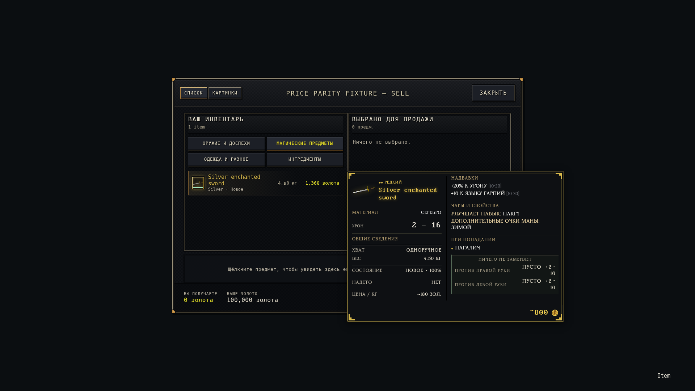
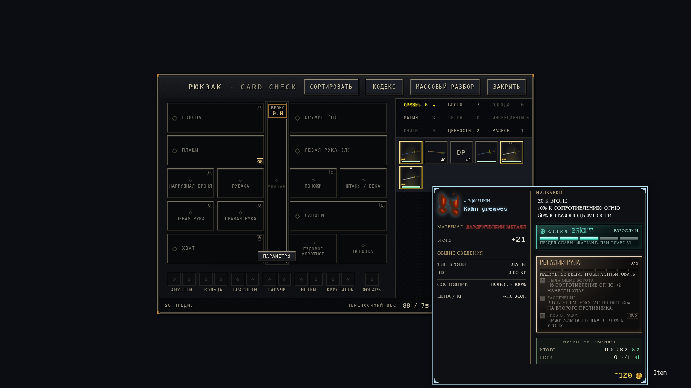

# Карточки предметов 1.19.3

В собственных группах свойств заголовки и постоянные префиксы песочные,
значения и названия эффектов белые, конечные диапазоны `[min-max]` тёмно-серые.
Точки эффектов при попадании сохраняют прежний цвет. Родные сигилы, наборы,
техники и сравнения переносятся теми же DOM-узлами с прежними цветами и обработчиками.
Префиксы без двоеточия берутся из локализованных `itemPowers` оригинала.

Материал перенесён в блок имени между названием и уроном/бронёй, шрифтом 12 px.
Подпись песочная, значение окрашено по металлу. Все десять металлов проверены
через настоящий декодер; у эбонита светлая обводка, у даэдрика красная.
Отсутствующие и скрытые данные не превращаются в угаданный металл.

## Цены

Формула остаётся утверждённой: 40% от исправленной родной базы продажи,
без магазина и личных навыков, с округлением общей суммы до 10 и знаком `~`.
Внизу только жёлтая сумма с монетой. Монеты и аккредитивы сохраняют точный номинал.

Цена неопознанных вещей теперь доступна: родной торговец тоже использует
сохранённую стоимость без проверки идентификации. Например, одинаковые вещи
со стоимостью 2500 дают `~1 000` до и после опознания. Скрытые чары, надбавки
и сравнения при этом остаются закрытыми. Вещи не изменяются.

Расхождение оценки между инвентарём и торговлей на одинаковом объекте
не воспроизвелось. Стенд наводит курсор на настоящие строки инвентаря,
`Sell`, `SellMagic` и `Buy`, меняет магазин и навыки. Проведены 30 сравнений
без русификации и 30 с ней. Включены стопки, найденное состояние, ремонт,
крафт, даэдрик и неопознанные вещи. Собственное предложение торговца в его
списке зависит от навыков/магазина и может отличаться от общей оценки карточки.

## Проверки

Основной источник — <https://github.com/Lattymoy/daggerfall-js-source>.
Публичный снимок `a3eb1605ea1dc391b691fe314377458a7e63e483` не обновляется
вместе с игрой, поэтому исполнены опубликованные ассеты с проверенными SHA-256.

- На `0.1.14533` код из итогового payload прошёл 13 760 проверок состояний
  отдельно для hover и выбранной вещи: 483 шаблона каталога, чары, аффиксы,
  материалы, статусы, сигилы/наборы, сокеты и другие интеграции.
- Дополнительно проверен новый `0.1.14536`: все 7 хуков, 19 примеров карточек,
  родные торговые формулы, настоящие окна продажи, 501 сочетание шаблона/категории
  и 132 сочетания размера экрана и положения окна. Связанные нативные модули
  совпадают с предыдущим релизом после нормализации хешей импортируемых файлов.
- При 1000 открытиях/закрытиях не осталось активных наблюдателей карточек.
  Повторная подгонка неизменённой карточки не вызывает измерений или записей DOM.
  Подгонка, смена размера и посторонний HUD не пересчитывают цену.
- Пройдены 14 модульных/упаковочных проверок и тесты Go-установщика.
  Все 31 встроенный файл мода побайтно совпадают с исходниками.

[Машинный отчёт с хешами и результатами](item-cards-1.19.3-checks.json).
Это проверки настоящего рендерера на контролируемых предметах, без сетевой
торговли. Они не заменяют проверку на персонаже пользователя и не доказывают
полноту всех возможных серверных предметов. В каталоге есть 26 стендовых
регистраций динамических шаблонов, что явно отражено в отчёте.

Повтор: `test/item-cards.test.cjs`, `tools/test-item-cards-browser.cjs`,
`tools/test-item-card-states.cjs`, `tools/test-item-card-trade.cjs`,
`tools/audit-item-prices.cjs`, `tools/audit-item-cards-browser.cjs`.
Для проверки именно встроенной версии задайте `DFO_CARD_MOD_DIR` на
`dist/payload/mod`; для русской торговли — `DFO_CARD_TRADE_RU=1`.
