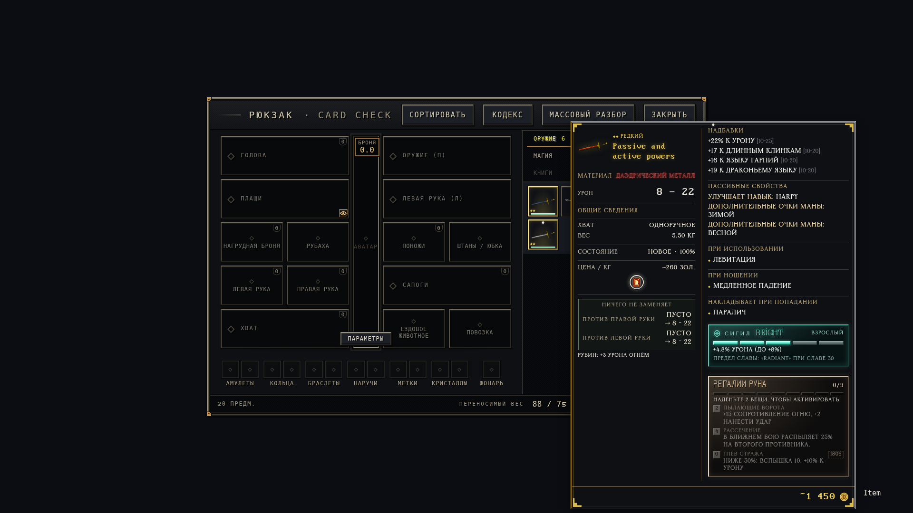

# Балансировка карточек 1.19.4

Разделы переименованы в **«Пассивные свойства»** и
**«Накладывает при попадании»**.

При подгонке карточка сравнивает цельные хвостовые блоки правого столбца.
Вариант с наименьшей высотой переносится под общие сведения слева.
Высота измеряется заново при реальной ширине левого столбца: дополнительные
переносы строк могут сделать перемещение невыгодным. Слишком широкие блоки
остаются справа. При равной высоте предпочтителен меньший перенос.

Блоки сохраняют исходный порядок внутри переносимого хвоста. Сигилы,
наборы, сравнения и другие интеграции перемещаются теми же узлами DOM,
с прежним содержимым и обработчиками. Строки не делятся и не скрываются.
Обычные короткие карточки остаются в прежней раскладке. Ценник и шрифты не меняются.

Сравнение на контролируемых предметах в настоящем рендерере, 1920×1080:

| Пример | Без переноса, px | После переноса, px | Перенесено блоков |
|---|---:|---:|---:|
| Обычная кираса | 382 | 382 | 0 |
| Наголенники Руна | 555 | 477 | 1 |
| Набор с множеством эффектов | 890 | 752 | 2 |
| Пассивные и активные свойства с набором | 955 | 817 | 2 |

Это стендовые предметы с нативными блоками, а не восстановленные вещи персонажа.

## Проверки

Оригинал — <https://github.com/Lattymoy/daggerfall-js-source>;
исполнены проверенные по SHA-256 ассеты **app-v0.1.14536**.

- Семь примеров сравниваются с независимым DOM-стендом всех допустимых
  хвостовых переносов. Проверяются уменьшение высоты, сохранение тех же узлов
  и порядка после изменения доступной ширины, работа обработчиков.
- Новые данные в открытой карточке обрабатываются даже при неизменной внешней
  высоте и немедленном штатном `fitCard`. Перерасчёта цены при этом нет.
- Сорок повторных подгонок неизменённой карточки не запускают новую балансировку;
  собственные переносы не зацикливают MutationObserver.
- Полная матрица из 13 760 состояний проверяет соответствие родным свойствам,
  статусам и DOM интеграций в обоих столбцах. После 1000 открытий/закрытий
  не остаётся активных наблюдателей закрытых карточек.
- Проверены 132 сочетания экрана/положения, очень длинный тултип со 120
  дополнительными блоками, посторонние обновления HUD и аварийное уменьшение.
  Внутренней прокрутки и обрезания строк нет.
- Модульные проверки, упаковка/установка/удаление и тесты Go-установщика пройдены.
  Код из payload побайтно совпадает с исходниками.

[Машинный отчёт](item-cards-1.19.4-checks.json). Проверки используют настоящий
опубликованный JS и локальные данные; это не проверка сетевой игры на персонаже.

Повтор: `tools/test-item-card-balance.cjs`, `tools/test-item-card-states.cjs`,
`tools/test-item-cards-browser.cjs`, `tools/audit-item-cards-browser.cjs`.
Для кода из установщика задайте `DFO_CARD_MOD_DIR=.../dist/payload/mod`,
для полной русификации — `DFO_CARD_AUDIT_FULL_RU=1`.
